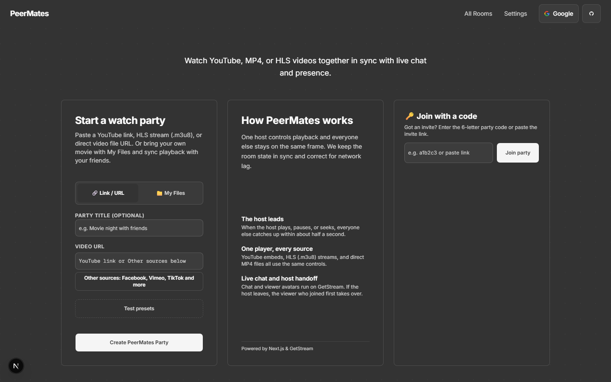
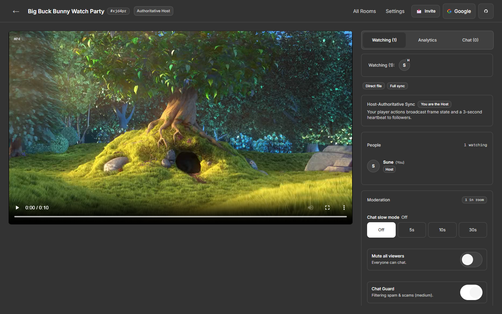
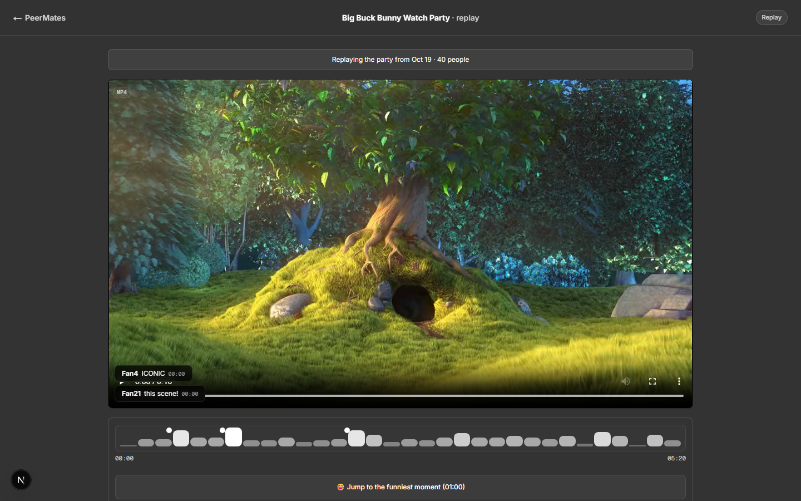
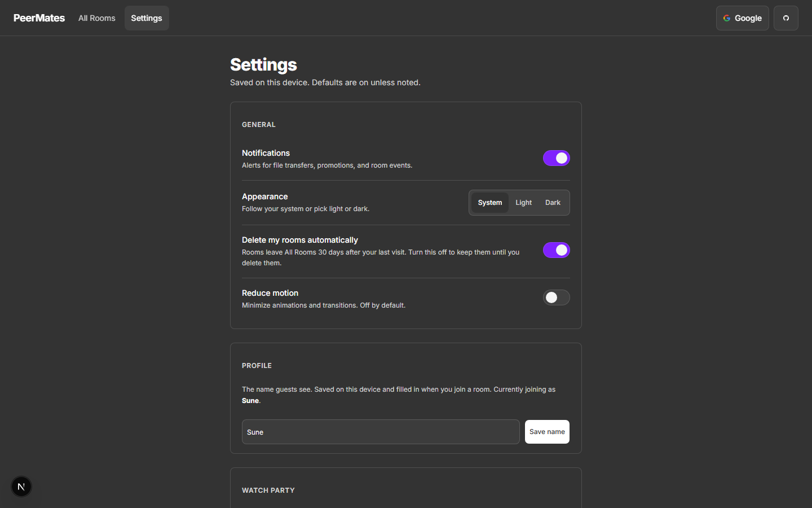
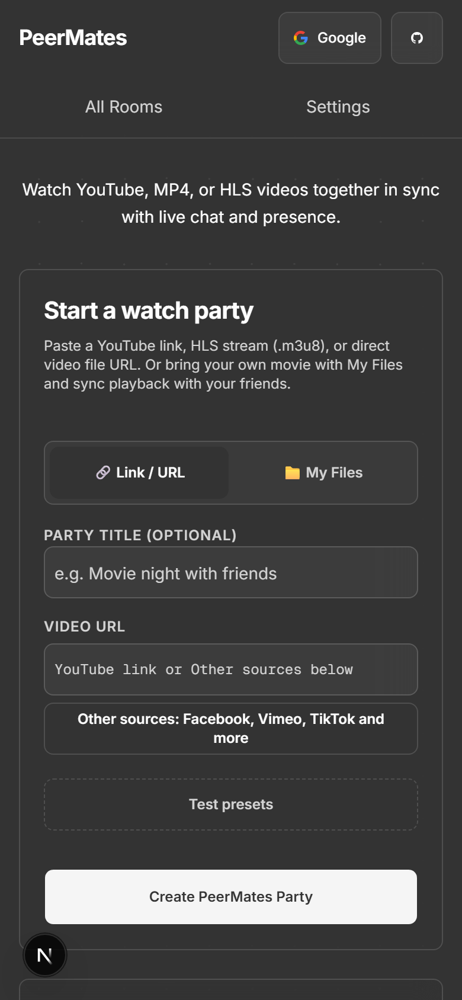
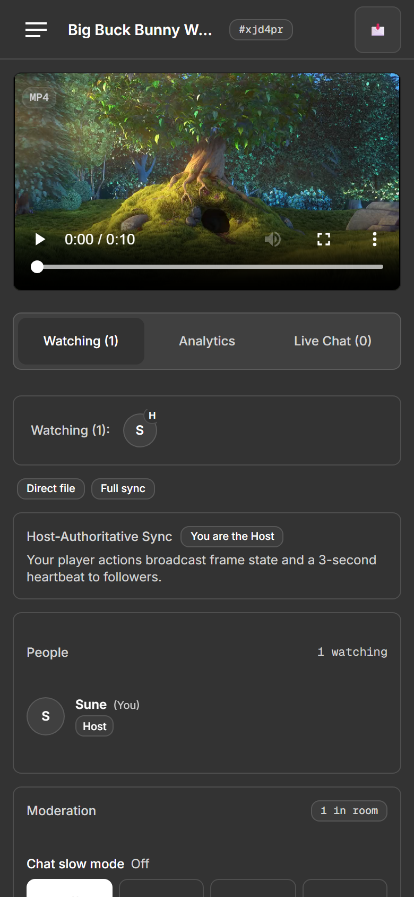
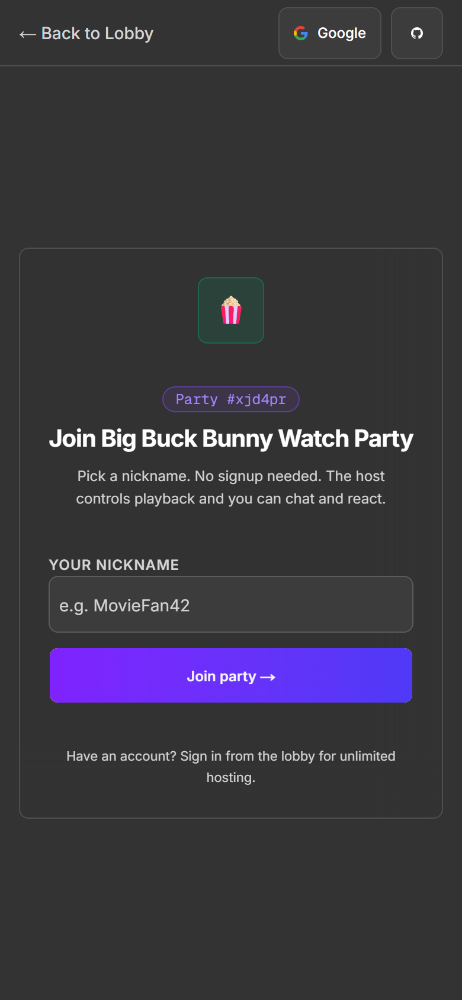
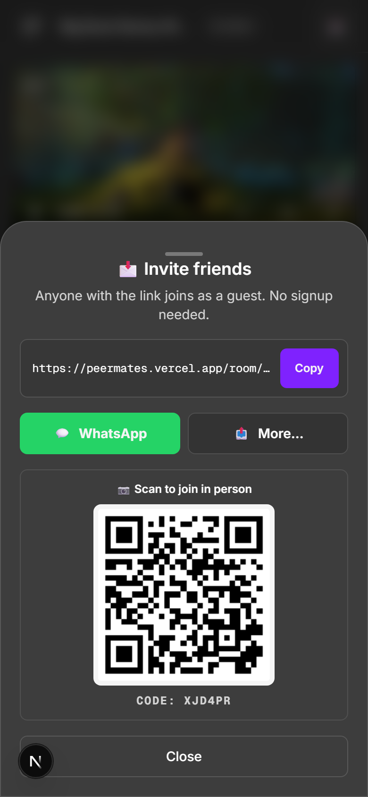
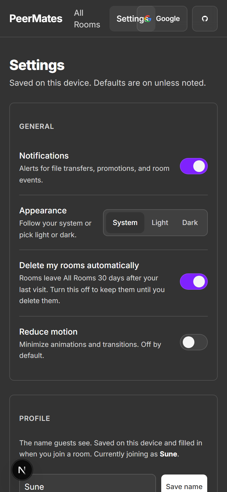
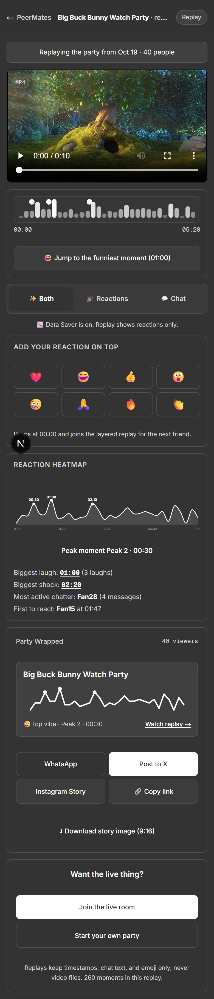

# PeerMates 🍿

Built with ❤️ by [@sunejrn](https://x.com/sunejrn)

Watch movies from your own device together in frame-accurate sync — no uploads,
no screen sharing, and no remote video links. Every device plays its own copy;
only timestamps and a tiny file fingerprint sync through the server. Includes
live chat, voice notes, AI-translated subtitles, moderation, and host-controlled
playback.

## Screenshots

### Desktop

| Lobby — start or join a party | Watch room — synced player + live panels |
| --- | --- |
|  |  |

| Party Replay — heatmap, highlights, and Wrapped | Settings — appearance, chat, playback, data |
| --- | --- |
|  |  |

### Mobile (390px)

| Lobby | Watch room |
| --- | --- |
|  |  |

| Room access gate | Invite sheet — link, WhatsApp, QR |
| --- | --- |
|  |  |

| Settings | Party Replay (full page) |
| --- | --- |
|  |  |

> Screenshots are static captures of the lobby (`/`), the watch room
> (`/room/[slug]`), the invite sheet, settings (`/settings`), and a saved Party
> Replay (`/replay/[id]`). Some captures may predate the latest local-file-only
> UI. To retake them, run the dev server, sign in, create a room from your own
> file, and screenshot at 1440×900 and 390×844.

## Features

**Watch together**
- Local-file rooms: each device plays its own copy of the same movie. Video
  bytes never upload; only playback state and a tiny fingerprint travel.
- Host-authoritative sync: play, pause, and seeks reconcile within ±0.5s
  (gentle rate-nudge for small drift, one debounced seek for large drift)
- Fingerprint matching: size, duration, and three sampled 1 MB hashes are
  compared before joining. Mismatched files are clearly flagged.
- Host streaming fallback: viewers without the file can watch the host's
  playback over WebRTC, automatically when the host starts sharing.
- 3s host heartbeat + Redis playback snapshots, so late joiners land in sync
- Tap-to-play overlay for iPhone Safari autoplay blocks; fullscreen on iPhone
  (`webkitEnterFullscreen`) and Android/desktop (standard Fullscreen API)
- Automatic host migration when the host disconnects

**Clarity Engine (client-only, free)**
- Off / Light / Ultra switch in the Watching tab. Light is a subtle
  contrast + saturation lift. Ultra redraws native frames through a WebGL
  edge-aware sharpen shader.
- Ultra falls back to Light on unsupported/tainted video or below the perf
  threshold. It respects Data Saver + audio-only (off), releases the GPU on
  pause / tab-hide / PiP / leave, and reports live fps while running.
- Local playback keeps CPU/GPU work on-device; no server-side transcoding.

**Rooms & sharing**
- Create a room by picking a movie file from your device; the file stays on
  that device and loads automatically on return visits via IndexedDB
- Google or GitHub sign-in is required to create, join, or reopen a room.
  Replay pages keep a local guest identity for reactions.
- Join with a 6-letter code or pasted invite link. Joining is automatic after
  a short validation delay — no separate Join button.
- Pending create/join intent survives the OAuth redirect: after signing in,
  the same file and room setup finish automatically.
- All Rooms (`/rooms`) — a private list of rooms visited by the signed-in
  account. Signed-out visitors see a sign-in gate; entries expire 30 days
  after the last visit unless disabled in Settings.
- Invite sheet: a prominent “Join straight from the link” panel, copy link,
  one-tap WhatsApp share, native share sheet, and a QR code for in-person
  sharing.

**Chat**
- Optimistic sending: text, images, GIFs, video, voice notes, and files appear
  instantly while upload/persistence finishes in the background
- WhatsApp-style voice notes (tap to record, preview with speed control, send),
  optional push-to-talk (hold to record, release to send)
- Photo/file attachments with on-device compression, view-once media, replies,
  emoji reactions, typing indicators, slow mode, and viewer mute-all
- Image-only messages render without a chat bubble backdrop in both light and
  dark themes. Text and captioned messages keep their chat bubbles.
- Message count tracks visible messages (deleted tombstones excluded)
- **Chat Guard** (server-side, fail-open): automatic spam & scam filtering
  with low/medium/high sensitivity and an on-demand Guard log. Chat never
  blocks on the guard — slow or unreachable engine means the message is allowed

**Subtitles + AI**
- Host/co-host uploads `.srt`/`.vtt` — synced for everyone via `<track>`
- Per-viewer language (AI-translated, cached forever by file-hash + language)
  and per-viewer caption size
- "Catch me up" recap of everything said so far (cached by file-hash + minute)
- Provider-agnostic `lib/ai.ts`: `AI_PROVIDER=gemini|openrouter|claude`
  (default Gemini Flash-Lite free tier; OpenRouter credit exhaustion falls back
  to Gemini automatically; quota errors keep original subtitles playing)

**Host streaming & file transfer (P2P, small groups)**
- "Stream from host" sends the host's local video straight to viewers over
  WebRTC — STUN plus configurable TURN (OpenRelay fallback) for tricky NATs
- Honest about scale: the host uploads once per viewer with quality capped
  automatically, so it tops out at 8 receivers. Big rooms should share a
  link or matching local files (zero media bandwidth)
- Send a file over a WebRTC DataChannel (128 KB chunks, low-buffer backpressure,
  4 GB guard) — bytes go peer-to-peer, a server never stores them
- Sender and receiver both get a persistent 1–100% transfer card; when it
  reaches 100% it offers Play, which loads the movie and starts playback on
  that device (the card never blocks or dismisses on outside clicks)

**Roles & moderation (server-enforced, never UI-only)**
- Host + host-appointed co-hosts: playback control, source changes, kicks,
  mutes, slow mode, Chat Guard, host streaming. Viewers: chat + react only
- Upstash role check on every control event plus GetStream channel role
  mirroring; automatic host migration when the host disconnects
- Upstash rate limits on state writes, chat, presence, reactions, room
  creation/joins, moderation, finalize, and all AI calls

**Party Replay**
- Every reaction, message, voice note, and pin is captured with its video
  timestamp (buffered in Redis, flushed to Neon in batches — video never stored)
- Host ends the party and saves public / circle / private (or discards);
  reaction heatmap with labeled peaks plus auto-highlights (biggest laugh,
  shock, funniest voice note, top chatter, first reactor)
- Layered replay: late friends watch with the crowd, add their own reactions
  on top, and delete their own moments
- Party Wrapped share card (OG + 9:16 story image) and a `/replay/[id]` page
  with a "Join the live room" CTA when the party is still running

**Live analytics**
- Room Analytics tab (mobile + desktop): message activity over the session as
  a smooth SVG curve, with the Top chatters list directly below it. No
  reaction/count stat tiles — pure CSS/SVG, no chart library

**Settings & personalization (`/settings`)**
- Appearance: follow system, or force light / dark (applied instantly,
  persisted on-device)
- Chat: typing indicators, message sounds, message text size, presence
  avatars, global live-chat visibility
- Playback defaults: autoplay, audio-only, Data Saver, data-cost region
- Saved nickname for replay/guest identity, room history auto-delete
  (30 days), reduce motion, confirm-before-leave, data export / clear, and
  in-app bug reporting (emailed via Resend)

**Data awareness**
- Data Saver mode + a live session data meter with regional cost estimates
  (approximate prepaid mobile-data prices, always labeled as estimates)

**Flat Vercel-style UI**
- No shadows anywhere — cards, popovers, dialogs, and buttons render with
  neutral borders only
- Monochrome notifications: a single theme-aware toast style (no per-type
  colors)

**Mobile-first & PWA**
- 360px-first layout, 44px tap targets, safe-area insets, `dvh` units, no
  horizontal scroll; hidden-scroll chat with pinned input bar
- Installable PWA with an install spotlight/card (Android `beforeinstallprompt`
  + iOS Add-to-Home-Screen steps) and an offline shell (`/offline`)

## Tech stack

| Layer | Choice |
| --- | --- |
| App | Next.js 16 (App Router) + React 19 + Tailwind CSS 4 |
| Realtime | GetStream Chat (`livestream` channels; polling fallback) |
| State | Upstash Redis (presence, playback, roles, subtitles, guard, rate limits) |
| DB | Neon Postgres + Drizzle ORM |
| Auth | better-auth (Google + GitHub OAuth) |
| AI | Gemini / OpenRouter / Claude via `lib/ai.ts` |
| Chat Guard | Python sidecar (`api/chatguard.py`) called server-side, fail-open |
| Video | Native `<video>`, local object URLs, IndexedDB persistence, ClarityCanvas |
| P2P | WebRTC (STUN + configurable TURN, OpenRelay fallback) for host streaming & file transfer |

## Getting started

```bash
npm install
npm run dev   # http://localhost:3000
npm run test:parser  # provider URL parser unit tests (no runner needed)
```

Copy `.env.example` to `.env.local` and fill in:

| Variable | Where from |
| --- | --- |
| `DATABASE_URL` | Neon dashboard → connection string |
| `BETTER_AUTH_SECRET` | any random 32+ char string |
| `BETTER_AUTH_URL` | `http://localhost:3000` locally; prod URL on Vercel |
| `NEXT_PUBLIC_SITE_URL` | `https://peermates.vercel.app` — canonical URL for invite links, QR codes, shares |
| `GITHUB_CLIENT_ID` / `GITHUB_CLIENT_SECRET` | GitHub → Settings → Developer settings → OAuth Apps |
| `GOOGLE_CLIENT_ID` / `GOOGLE_CLIENT_SECRET` | Google Cloud Console → APIs & Services → Credentials |
| `STREAM_API_KEY` / `STREAM_API_SECRET` / `NEXT_PUBLIC_STREAM_API_KEY` | [getstream.io](https://getstream.io) dashboard |
| `UPSTASH_REDIS_REST_URL` / `UPSTASH_REDIS_REST_TOKEN` | [console.upstash.com](https://console.upstash.com) |
| `AI_PROVIDER` | `gemini` (default), `openrouter`, or `claude` |
| `GEMINI_API_KEY` (+ `GEMINI_MODEL`) | AI Studio (free tier; also the automatic fallback) |
| `OPENROUTER_API_KEY` (+ `OPENROUTER_MODEL`) | [openrouter.ai](https://openrouter.ai) keys page |
| `CLAUDE_API_KEY` (+ `CLAUDE_MODEL`) | Anthropic console |
| `NEXT_PUBLIC_ENABLE_PTT` | optional `1` to enable hold-to-record push-to-talk (default off) |
| `NEXT_PUBLIC_TURN_URLS` / `NEXT_PUBLIC_TURN_USERNAME` / `NEXT_PUBLIC_TURN_CREDENTIAL` | optional TURN relay for strict NATs; falls back to OpenRelay |
| `RESEND_API_KEY` / `REPORT_FROM` | Resend (in-app bug reports; server-only) |

> `VERCEL_URL` is picked up automatically on Vercel and used as a fallback
> origin for the Chat Guard sidecar and share links.

```bash
npm run build   # production check
npm start       # serve the production build
```

## Google OAuth setup

1. In Google Cloud Console, create an **OAuth 2.0 Client ID** (Web application).
2. Under **Authorized redirect URIs**, add one per environment:
   - `http://localhost:3000/api/auth/callback/google`
   - `https://<your-app>.vercel.app/api/auth/callback/google`
3. Paste the client ID/secret into `.env.local` (local) and Vercel
   Project → Settings → Environment Variables (production, then redeploy).
4. Production also needs `BETTER_AUTH_URL=https://<your-app>.vercel.app`,
   otherwise the OAuth callback returns to the wrong host.

## AI subtitles setup

- Set `AI_PROVIDER=openrouter` and paste `OPENROUTER_API_KEY` to translate
  with OpenRouter. If its credits/quota run out, calls automatically retry on
  the Gemini free tier (requires `GEMINI_API_KEY`).
- Set `AI_PROVIDER=claude` + `CLAUDE_API_KEY` to move to Claude later — no
  feature code changes needed.
- All AI keys are server-only (no `NEXT_PUBLIC_` prefix); the browser never
  sees them.

## TURN relay setup (optional)

WebRTC works directly on most home networks. For friends on different
networks, strict NATs, or mobile carriers, configure a TURN relay:

```env
NEXT_PUBLIC_TURN_URLS=turn:your-relay.example.com:3478,turns:your-relay.example.com:5349?transport=tcp
NEXT_PUBLIC_TURN_USERNAME=your_turn_username
NEXT_PUBLIC_TURN_CREDENTIAL=your_turn_password
```

- Leave these unset to use the best-effort public OpenRelay fallback.
- Restart `npm run dev` after changing them; for Vercel, add the same
  variables and redeploy.
- Verify the relay with Metered's
  [TURN Server Testing Tool](https://www.metered.ca/turn-server-testing).
- Static credentials work for small rooms. For production, rotate short-lived
  credentials with the
  [Metered TURN REST API](https://www.metered.ca/docs/turn-rest-api/).

This app uses native WebRTC, not Metered's Video SDK, so the Metered Video
REST API and Video SDK guides are not required.

## Project structure

```
app/
  page.tsx                 Lobby: create a room + join by code
  rooms/page.tsx           All Rooms (sign-in gate, per-account history)
  room/[slug]/page.tsx     Watch room (player, chat, watching, analytics)
  replay/[id]/             Party Replay + OG image + 9:16 story route
  settings/page.tsx        Settings
  offline/page.tsx         PWA offline shell
  api/rooms/[slug]/…       state, presence, messages, roles, moderation,
                           guard, localfile, signals, subtitles,
                           subtitles/translate, recap, finalize, …
  api/replay/[id]/…        replay data + events
  api/report-bug/          Resend email for in-app bug reports
api/chatguard.py           Chat Guard Python sidecar (fail-open)
components/
  player/                  Native player + VideoPlayer wrapper + ClarityCanvas
  chat/                    ChatPanel + VoiceRecorder + EmojiPicker
  room/                    RoomLobby, JoinByCode, LocalFileGate, InviteSheet,
                           ModerationPanel, GuardLogSheet, StreamFromHost,
                           SendFilePanel, …
  pwa/                     Install card + spotlight
hooks/                     useWatchSync, useLocalFilePick, useRoomSubtitles,
                           useGuestIdentity (replay), useDataSaver,
                           useDataMeter, useClarity, useAppSettings, …
lib/
  ai.ts                    Provider-agnostic LLM module (server-only)
  guard/engine.ts          Chat Guard client (server-only, fail-open)
  webrtc/                  P2P host streaming + DataChannel file transfer
  data/pricing.ts          Mobile-data cost estimates
  redis/                   Upstash stores with in-memory dev fallback
  rooms/                   Room records/cache, roles, invite codes, history
  replay/                  Heatmap/highlights + persistence
  subtitles/               SRT/VTT parse + serialize (shared client/server)
  video/
    detector.ts            Local-file/source helpers
    localfile.ts           Fingerprints, validation, labels
    localFileDb.ts         IndexedDB file persistence + host fingerprint cache
    parseUrl.ts            URL parser (kept for tests/legacy helpers)
    clarity.ts             Clarity Engine tiers + capability detection
db/                        Drizzle schema + client (Neon)
public/screenshots/        README screenshots
```

## Roadmap

These are the planned or in-progress directions, drawn from notes and
feature-flagged code in the repo:

- **Host streaming at scale** — WebRTC P2P currently tops out at 8 receivers;
  an SFU (e.g. LiveKit's free tier) is the planned upgrade for large
  host-streamed rooms. Matching local files remain the zero-bandwidth path.
- **Claude as a first-class provider** — `lib/ai.ts` already routes
  `AI_PROVIDER=claude`; it's wired and ready to switch on, alongside the
  Gemini/OpenRouter defaults.
- **Clarity Ultra on WebGPU** — WebGPU is feature-detected for reporting today;
  WebGL is the shipping path, with WebGPU as the intended faster tier.
- **Push-to-talk** — implemented behind `NEXT_PUBLIC_ENABLE_PTT` and off by
  default; slated to default on after broader device testing.

## Deploy on Vercel

Import the repo in Vercel, add every variable from `.env.example` to the
project Environment Variables (including `BETTER_AUTH_URL` with the production
URL and the Google/GitHub OAuth credentials), then deploy. OAuth providers
need the production redirect URIs registered (see Google setup above; same
pattern for GitHub: `https://<your-app>.vercel.app/api/auth/callback/github`).

Chat Guard ships as a Python serverless function at `api/chatguard.py` in the
same project — Vercel detects and deploys it alongside the Next.js app, and
`lib/guard/engine.ts` calls it server-side (with a short timeout and
fail-open behavior).

## Contributing

See [CONTRIBUTING.md](CONTRIBUTING.md) for setup, code rules, and the PR
checklist (server-side auth, rate limits, mobile-first, screenshots).

## License

MIT — see [LICENSE](LICENSE).

---

Built with ❤️ by [@sunejrn](https://x.com/sunejrn)
